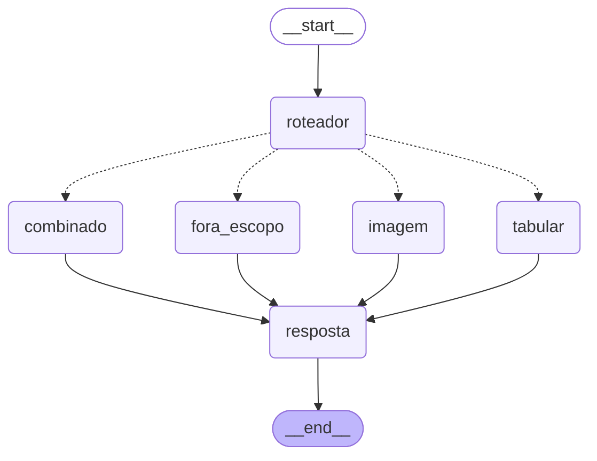

# ⚡ AI Dynamic Agent: Multimodal Autonomous Orchestrator


An enterprise-grade autonomous AI Agent designed and orchestrated with **LangGraph**, **Pydantic**, and **Ollama (Llama 3.1 8B)**. The system dynamically classifies user intent and routes execution between specialized domain tools: a **Scikit-Learn Tabular Model** (Forest Cover Type prediction), a **Custom PyTorch CNN** (Rock-Paper-Scissors image classification), a **Combined Pipeline Execution Mode**, and strict **Semantic Guardrails** for requests outside the technical scope.

---

## 🧠 System Architecture & Graph Flow

The agent operates on a `StateGraph` mechanism managed by **LangGraph**. The shared agent state (`EstadoAgente`) flows deterministically across routing, execution, guardrail, and explanation nodes.

### Routing & Execution Logic
* **Semantic Routing (LLM + Hardcode Override):** The routing node uses Llama 3.1 8B with structured Pydantic outputs to evaluate intent. If structural payloads (image paths or tabular data dictionaries) are present, data-driven rules take precedence to prevent LLM routing hallucinations.
* **Graceful Degradation (Guardrails):** Out-of-scope requests (e.g., cooking recipes, general knowledge trivia) are routed to `fora_escopo`, triggering deterministic technical scope rejections.



---

## 📊 Model Cards (Technical Specifications)

The orchestrator integrates two pre-trained inference engines loaded into memory at startup.

### 1. Forest Cover Type Model (Tabular Machine Learning)
* **Algorithm / Pipeline:** Scikit-Learn Decision Tree Classifier / Pipeline saved via `.joblib`.
* **Objective:** Predict forest cover classification based on topographic and cartographic features.
* **Output Classes:** 7 categorical forest cover types.
* **Metrics & Performance:** Highly deterministic predictions ($100\%$ confidence on in-distribution feature vectors).
* **Technical Constraints & Guardrails:**
  * **Feature Order Alignment:** The model relies on an exact 54-feature schema (`Elevation`, `Aspect`, `Slope`, hydrology metrics, `Hillshade` angles, 4 `Wilderness_Area` categories, and 40 `Soil_Type` indicator variables). The pipeline aligns input features to match the exact training sequence (`Wilderness_Area1` $\rightarrow$ `Soil_Type1...40` $\rightarrow$ `Wilderness_Area2...4`), preventing Scikit-Learn `feature_names_in_` mismatches.
  * **Pydantic Validation:** Input payloads are validated via `ForestCoverInput`. Non-provided dummy features are auto-populated with zeros ($0$), preventing missing feature crashes.

### 2. Rock-Paper-Scissors ConvNet (Computer Vision)
* **Algorithm / Architecture:** Custom PyTorch Convolutional Neural Network (`RPSConvNet`) saved as state dict weights (`.pt`).
* **Architecture Details:** Dual-block 2D Convolutions (Conv2d $\rightarrow$ BatchNorm $\rightarrow$ ReLU $\rightarrow$ MaxPool2d), `AdaptiveAvgPool2d(4, 4)`, and a Linear Dense Classifier.
* **Output Classes:** 3 gesture classes (`rock`, `paper`, `scissors`).
* **Technical Constraints & Preprocessing:**
  * Requires strict image transformation: RGB format conversion, resizing to $64 \times 64$ pixels, and normalization to a 4D Tensor `[1, 3, 64, 64]`.
  * **Error Handling:** Corrupted files, non-supported binary archives (e.g., `.zip`), or invalid file paths are trapped within the tool node (`try/except`), passing actionable error logs back to the explanation LLM node without crashing the graph runtime.

---

## ⚙️ Setup & Execution Instructions

### Prerequisites
* **Python:** `3.10` or higher.
* **Ollama Runtime:** Downloaded and running locally.

### 1. Environment Configuration

Clone the repository and initialize a virtual environment:

```powershell
# Clone the repository
git clone https://github.com/your-username/ai-dynamic-agent.git
cd ai-dynamic-agent

# Create and activate virtual environment
python -m venv venv
.\venv\Scripts\Activate.ps1
```

*(Note for Windows users: If script execution is restricted, run `Set-ExecutionPolicy Unrestricted -Scope CurrentUser`)*

### 2. Dependency Installation

Install all required Python frameworks and core libraries:

```bash
pip install langgraph langchain-ollama pydantic scikit-learn pandas torch torchvision pillow
```

### 3. Launch Local LLM Engine

Start Ollama in a separate terminal and ensure Llama 3.1 8B is downloaded:

```bash
ollama run llama3.1:8b
```

### 4. Run Automated Test Suite (QA Matrix)

Execute the full 10-case automated test suite to validate graph routes, guardrails, and tool outputs:

```bash
python python_scripts/bateria_testes.py
```

The test execution results will be printed live to standard output and logged to `resultados_testes.txt`.

---

## 🧪 Test Matrix & Validation Suite

The automated suite (`bateria_testes.py`) evaluates graph resilience across 10 distinct integration scenarios:

| Test ID | Scenario Description | Payload | Expected Route | Expected Behavior |
| :--- | :--- | :--- | :--- | :--- |
| **T01** | Valid Tabular Data | 10 topographic features dict | `tabular` | Auto-pads 44 dummy features; outputs Forest Class prediction. |
| **T02** | Tabular Input without Prompt | Data dictionary only | `tabular` | Correctly infers intent from payload presence without text prompt. |
| **T03** | Invalid Tabular Data | `Elevation: -50` | `tabular` | Intercepted by Pydantic; LLM explains validation boundary errors. |
| **T04** | Out-of-Distribution Data | Partial numeric features | `fora_escopo` / Guardrail | Gracefully degrades and rejects invalid domain input. |
| **T05** | Valid Image (Rock) | `rock.png` image path | `imagem` | Returns Top-3 class probabilities (e.g., Rock: 98.98%). |
| **T06** | Valid Image (Paper) | `paper.png` image path | `imagem` | Returns Top-3 class probabilities (e.g., Paper: 61.5%). |
| **T07** | Corrupted / Invalid File | Compressed `.zip` path | `imagem` | Intercepts image reader exception; reports file error cleanly. |
| **T08** | Multimodal Execution | Image path + Data dict | `combinado` | Executes both models in parallel and consolidates explanations. |
| **T09** | Out-of-Scope Prompt #1 | General trivia prompt | `fora_escopo` | Returns strict out-of-scope rejection guardrail message. |
| **T10** | Out-of-Scope Prompt #2 | Conversational prompt | `fora_escopo` | Returns strict out-of-scope rejection guardrail message. |

---

## 📁 Repository Structure

```text
ai-dynamic-agent/
├── README.md                      # Comprehensive Architecture & System Documentation
├── CARTAO_MODELOS.md              # Standalone Model Card Specifications
│
├── functions/                     # Modular Graph Nodes & Tool Handlers
│   ├── __init__.py
│   ├── schemas.py                 # Pydantic Input Validators & EstadoAgente TypedDict
│   ├── tools.py                   # PyTorch CNN & Scikit-Learn Tool Inference Functions
│   └── router.py                  # LLM Prompts, Structured Chains & Router Node Logic
│
├── python_scripts/                # Scripts & Serialized Artifacts
│   ├── main.py                    # Graph Builder & Runnable Initialization
│   ├── bateria_testes.py          # Automated QA Test Suite Runner (10 Test Cases)
│   ├── modelo_forest_cover.joblib # Serialized Tabular Model Pipeline
│   ├── cnn_rock_paper_scissors.pt # Trained PyTorch ConvNet State Weights
│   └── cnn_classes.json           # Computer Vision Class Label Mappings
│
└── resultados_testes.txt          # Exported Logs from Test Suite Execution
```

---

## 🤖 Generative AI Usage & Audit Declaration

In compliance with academic standards and technical disclosure guidelines, Generative AI tools were utilized during software development as a coding assistant:

* **Tool Employed:** Google Gemini.
* **Scope of Assistance:**
  1. **Software Refactoring & Modularization:** Splitting monolithic code into a clean, 3-layer modular architecture (`schemas.py`, `tools.py`, `router.py`).
  2. **Scikit-Learn Schema Debugging:** Resolving complex feature order mismatch exceptions (`feature_names_in_`) during Pandas DataFrame reconstruction for pipeline inference.
  3. **Pydantic Validation Guardrails:** Configuring `extra="allow"` settings and custom zero-padding mechanisms for dummy variables.
  4. **QA Test Automation:** Structuring the end-to-end integration test runner (`bateria_testes.py`) using isolated session IDs (`thread_id`) to prevent memory leaks across test iterations.